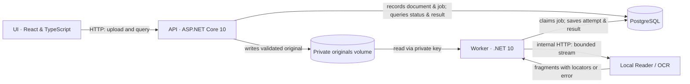

# HackthonSpurs · Base Architecture for Track 2

**Proposal for review · November 27, 2026 · No implementation yet.** The first walkthrough should allow uploading a test file, closing the UI, returning later, and seeing what could be read and **on which page or cell**. Processing completing does not mean the data is true or that the product complies with a standard.

## 1. Proposed Architecture

Five local services: **React/TypeScript UI, ASP.NET Core 10 API, .NET 10 Worker, local reader/OCR, and PostgreSQL**. The API accepts durable work; the Worker claims it from the database and calls the reader over HTTP. The reader returns evidence, not decisions. Original files are stored in a private Docker volume: that is storage, **not a sixth service**.



The browser only talks to the API through the same origin that serves the UI. There is **no** API → Worker call, no callback to the UI, no cloud provider, and no bulk loading of the corpus on startup. The reader receives neither database credentials nor access to the originals volume. To view a result, the UI queries the API; reloading the page does not trigger another job.

## 2. Evidence Driving the Design

**Starting point.** The [official repository](https://github.com/lokomurdok89/HackthonSpurs) had no commits or prior structure before cloning. The private ArenysMed handoff was reviewed, specifically sections 1 and 3–7: it is a static inspection of the source working tree, not a production certification. The local Phase 1 report (§§ 3–8), its 193-entry matrix, and the participant FAQ were cross-checked. No case filenames, commercial data, or copies of those inputs are included here.

| Confirmed Finding | Architectural Consequence |
|---|---|
| The matrix distinguishes 63 priority files, 63 complementary files, and 67 out-of-scope files. Among the priority files are 43 PDFs and 9 XLSX files. Phase 1 found 18 PDFs with no text layer and one PDF whose text layer contains only a footer. | Prioritize **PDFs and spreadsheets**, not universal OCR. Decide whether useful text exists **per page**, not just by whether the file has any text. Start with deliberate uploads, not bulk indexing. |
| Under CUSMA, a certification does not require a single template; Annex 5-A defines minimum data elements and Chapter 5 covers supporting documentation. Phase 1 found disputed classification and unproven input origin. | Every extracted value must point to its source. Do not replace "unknown" with the supplier's country, nor a disputed classification with the last value read. Do not calculate regional value content or issue a certification. [CUSMA, Chapter 5 and Annex 5-A](https://www.international.gc.ca/trade-commerce/trade-agreements-accords-commerciaux/agr-acc/cusma-aceum/text-texte/05.aspx?lang=eng). |
| DPP requirements depend on the product group and applicable regulation. In the analyzed case, a commercial request does not by itself prove a legal obligation; lot-level environmental evidence does not prove allocation to a specific order. | Keep design evidence, receiving evidence, and actual allocation separate. Preserve conflicting sources without merging them or elevating a marketing claim to verified data. Do not enforce DPP fields, generate QR codes, or publish a passport. [European Commission: DPP scope and granularity](https://single-market-economy.ec.europa.eu/single-market/digital-product-passport/explore-our-faqs_en). |
| The manufacturer's website, certificate, invoice, bill of materials, and receiving document can state different things. A photograph may contain no text and may not allow identifying a material. | The technical result states what was read, how, and where. An incomplete or unsupported reading is presented as such. If a web source is added in a later phase, preserve the reference and date; do not include a crawler or follow embedded links. |

### File Format Policy for the First Walkthrough

| Observed Format | Recommended Path & Locator | Scope |
|---|---|---|
| PDF (91) | Extract native text per page; if missing or only marginal content exists, rasterize that page and try OCR. Preserve the **original** page number and method used. Report ambiguous pages. | First vertical slice: one synthetic digital PDF and one synthetic scan. Include a mixed case before considering the reader complete. |
| XLSX (27), CSV (3) | Native reading; worksheet and cell/range, or row and column. Do not recalculate formulas, run macros, or resolve links; distinguish missing values from zero. | Include a synthetic materials sheet. CSV uses the standard library. |
| JPG (20), PNG (3) | OCR if transcribing a label, referencing the image; do not infer origin or material from appearance. | Low-cost extension after validating the PDF flow. Unsupported formats: explicit rejection. |
| DOCX (24), EML (18), EDI (4), TXT (2), ICS (1) | The right path would be text/tables by section, message parts, interchange segments, or lines; do not rasterize these files by default. | Defer. Priority evidence exists in DOCX, EML, and EDI, so the demo will be **partial**. Pick the next adapter based on the question it must answer, not file count. ICS is out of scope for the initial walkthrough. |

Formats are not accepted merely because they appear in the matrix. The allowlist will be identical in both the API and the reader. Neither the private report, nor OCR text, nor screenshots derived from the corpus are material for public tests.

## 3. What We Keep from ArenysMed and What We Change

| Topic | Verified in Handoff | Decision for HackthonSpurs |
|---|---|---|
| Acceptance & queries | API validates, stores original, persists request + outbox, returns `202`; query endpoints exist. | **Keep** durable acceptance, idempotency, hashing, and command/query separation. Rewrite the contracts. |
| Asynchrony | Publisher in API → RabbitMQ → Worker, with inbox, retries, and dead-letter queue. | **Replace** that path with a jobs table in PostgreSQL: one producer, one task type, and one Worker. Keep crash recovery without operating another service. |
| OCR | .NET port inside the Worker; can use local preprocessing and Google Document AI. Vertex is a separate stage. No HTTP OCR server. | **Change the boundary:** an independent local HTTP process for both native reading and OCR. Do not port cloud SDKs, prompts, extraction rules, or medical contracts. |
| Persistence | PostgreSQL with EF Core/Npgsql for the product; originals in private storage. MySQL is an external integration and Redis serves n8n. | **Keep** metadata/binary separation. Evaluate PostgreSQL based on the transactions the new system needs, not legacy inheritance. |
| Operations & testing | Options/DI, correlation IDs, attempts, sanitized logs, health checks, and synthetic tests. | **Keep the minimum:** validated config per host, structured logging, tests with real PostgreSQL and invented samples. Do not carry over n8n, SISMED, clinical management, third-party publishing, pipeline history, or the observability platform. |

**Database choice.** PostgreSQL is proposed because it allows committing the document and job in a single transaction, enforcing uniqueness, and claiming a row without holding a lock during OCR. SQLite would eliminate one container, but would force the API and Worker to share and coordinate a database file. An in-memory queue would lose work on restart; a broker would preserve deliveries, but would not remove the need to persist results or coordinate acceptance. At this volume, the accepted cost is one container and periodic polling. Revisit only if multiple consumers with distinct routes emerge or measured latency requires it. [PostgreSQL: row locking and SKIP LOCKED for queues](https://www.postgresql.org/docs/18/sql-select.html#SQL-FOR-UPDATE-SHARE).

## 4. Projects and Minimal Dependencies

**Future** directory tree; in this phase only this document is created. Code directories are not additional services.

```text
docs/ARCHITECTURE.md
HackthonSpurs.slnx
src/
  web/                       React + TypeScript; upload, status, evidence
  HackthonSpurs.Api/         ASP.NET Core 10; HTTP validation, ingestion, and queries
  HackthonSpurs.Worker/      .NET 10 BackgroundService; queue and reader HTTP client
  HackthonSpurs.Documents/   Shared .NET library; jobs, persistence, and files
  reader/                    Local HTTP service for native reading and OCR
tests/                       Transition, integration, and synthetic end-to-end tests
compose.yaml                 Five services and two persistent volumes
.env.example                 Variable names and non-sensitive example values only
```

- **UI:** React, TypeScript, Vite, and `fetch`. One upload form and one status/evidence view; no global state manager or WebSockets. The UI image proxy serves `/api` on the same origin.
- **API and Worker:** .NET DI, Options, logging, `HttpClient`, and cancellation. Both reference the `Documents` library; they do not reference each other. Separate transitions, EF Core 10/Npgsql access, and storage into folders; a single set of migrations. The reader client belongs only to the Worker.
- **Reader:** Proposed stack is Python with FastAPI/Uvicorn for HTTP, Poppler for PDF text/rasterization, and Tesseract for local OCR. For XLSX, add `openpyxl` in read-only (no execution) mode; CSV uses the standard library. These are proposed components, **not copies** of the original. No LLM is needed. Pin versions, languages, images, and licenses upon approving this phase; do not use floating tags in the reproducible demo.

## 5. Proposed Technical Flow and Contracts

1. **Manual upload.** `POST /api/documents` receives a multipart file and an idempotency key generated by the UI for that operation. The API checks size, actual file type, and the allowlist; it does not trust the extension or filename. For delimited text, it validates content and limits rather than a nonexistent binary signature. Responses: `413` for size, `415` for unsupported type, `409` if the same key arrives with different bytes.
2. **Acceptance.** The API writes to a private temp file with a byte limit, computes SHA-256, and moves the file to an opaque internal key. It then commits **document + pending job** in a single SQL transaction. Only then does it return `202 Accepted`, the ID, and `Location`. A retry with the same key and hash returns the same ID without duplicating work. A unique constraint arbitrates concurrent uploads; the loser cleans up only its own copy.
3. **Claim.** The Worker queries eligible jobs, takes one in a short transaction, increments the attempt count, and records a temporary **lease** with a token and expiration. It reads the original in read-only mode and verifies the hash. Heavy processing happens **outside** the transaction.
4. **Reading.** `POST /internal/read` receives the bounded stream, type, correlation ID, and contract version from the Worker. It does not accept host paths, URLs, or credentials. It returns a versioned technical result containing method, fragments, locators, and warnings—or a classified error. It does not write to PostgreSQL. Confidence is included only if the engine provides it. No final extraction schema is locked in.
5. **Result.** The Worker validates the response identity, version, size, and locators; only the holder of the active lease can commit **result + terminal state** in a transaction. Text is rendered as untrusted data, never executable HTML. The UI polls `GET /api/documents/{id}` with bounded polling until a terminal state, then fetches the reading via `GET /api/documents/{id}/result`. Querying never enqueues or repeats OCR.

### 5.1 First Demo Case: From Input Material to Supplier Certificate

**User question:** *"Does this certificate correspond to the bushing on my materials sheet, and what does it prove about its origin?"* The demo separates the two questions: linking a certificate to an input does not turn the supplier's country into the country of origin.

**Synthetic samples.** In the XLSX, row 12 of the `Materiales` sheet identifies bushing `CAS-014` and cites certificate `CERT-027`. The one-page PDF shows both identifiers, the material grade, and a Canadian supplier address. In the baseline sample everything is legible, but there is no declaration of origin.

1. **Upload.** The UI uploads the XLSX and PDF separately. The API saves each original in the private volume and returns `202 Accepted` per file only after recording its document and job in PostgreSQL.
2. **Reading.** The Worker claims each job and sends the file to the internal reader. For the XLSX, the reader returns the cells from row 12; for the PDF, it returns fragments from page 1, using local OCR only if needed. The Worker persists both results with their locators and, if reading is partial, the corresponding warning.
3. **Assisted comparison.** Returning to the UI, the user selects the row and queries results through the API. They can open **Materiales · row 12** and **Certificate · p. 1**, compare identifiers, and distinguish the declared grade from the supplier's address. The comparison is human: no matching engine or automated origin decision is proposed.

**Acceptance criteria.** Present the following variants with invented sources and verify both the visible message and the action that resolves the uncertainty:

| Test Variant | Result the User Must See | Action & Boundary |
|---|---|---|
| **Unconfirmed link.** Only the supplier matches; the candidate PDF does not allow verifying the certificate number or part reference. | *"Link unconfirmed."* Both the row and candidate page remain available to compare; the UI does not present the PDF as evidence for that bushing. | Look for the cited certificate or a linking document. Do not evaluate the input's origin from this PDF. |
| **Certificate does not demonstrate origin.** The user matches `CAS-014` and `CERT-027` across both sources. The complete, legible PDF shows the grade and supplier address, but no origin declaration. | *"Origin not demonstrated by this certificate."* The UI shows the matching identifiers and the page supporting the grade. It does not display "Canada" as origin, "non-originating," or "does not comply with CUSMA." | Request origin evidence from the supplier for that part (and lot, if applicable). Re-running OCR does not solve a documentation gap. |
| **Unreadable section.** Both identifiers remain legible and match, but in the scan the origin section is cropped or blurry. | *"Could not read the origin section; review page 1."* The warning points to the original page and preserves the verifiable link. It does not say "the certificate does not declare origin." | Open the original and, if still unreadable, request a legible copy. Do not fill in the data by inference. |

In all three variants, `Completed` describes the **reading job**, not the strength of the evidence. A valid partial read can finish with a located warning. None of these situations, on its own, marks the job `Failed` or triggers an automatic retry.

## 6. Persistence, States, and Failures

**Persistence responsibilities, not a final schema:** the document records identity, operation key, type, size, hash, and private file key. The job stores state, attempts, next run time, lease, and last error code. The result links document, reader version, and locators. Record start, end, and outcome per attempt to explain delays without storing content in logs. None of these entities define CUSMA or DPP fields.

| Event | Transition & Response |
|---|---|
| Acceptance confirmed | `Queued`. The user may leave the UI. If saving fails, acceptance is not returned. |
| Eligible job | `Queued → Processing`. Selected in order of availability and ID using row locking and `SKIP LOCKED`; commit lease before calling the reader. One Worker and one active job are enough initially. |
| Timeout, dropped connection, or temporarily unavailable reader | `Processing → Queued` with next run time and recorded attempt. Initial proposal: max **3 total attempts**, with 5 s and 30 s backoffs. Do not layer automatic HTTP client retries on top. |
| Worker crashes abruptly | The row does not disappear. The next cycle recovers expired leases using PostgreSQL's clock; if attempts remain, it claims with a new token; on the last attempt it marks `Failed`. A late response from the previous holder cannot overwrite anything. |
| Unsupported corrupt/encrypted file, hash mismatch, incompatible response, or attempts exhausted | `Failed`, with a safe code and document reference, without looping. A technical error does not equal missing regulatory documentation. |
| Valid read, even partial | `Completed` and a single active result per job. An unreadable or textless page is kept as a located warning: never invent content or mark it approved. |

**Guarantee:** at-least-once execution; a crash may repeat reading, never the active result. Final writes and error transitions also verify token, state, and expiration. Total read timeout must be shorter than the lease duration with margin to validate and save. Never hold a transaction open while waiting on HTTP.

**File/SQL boundary.** An atomic move within the same volume prevents publishing a half-written file, but does not form a transaction with PostgreSQL. On a confirmed SQL error, clean up your own copy; on an uncertain commit, query before deleting. A crash can still leave orphaned files with no row: plan a manual age-based orphan check, never an indiscriminate wipe of the volume or source corpus.

## 7. Docker, Configuration, and Data Control

- **Future execution:** from the root, prepare a Git-ignored local env and run `docker compose up --build`; check health with `docker compose ps`. These are not runnable commands in this phase. Only the UI will be published, bound to localhost/loopback. API, PostgreSQL, and reader use Compose internal DNS; the Worker needs no public port. No remote access or multi-user support in the demo: exposing it would first require authentication, per-document authorization, and TLS.
- **Volumes:** one for PostgreSQL; one for originals, read/write in the API and read-only in the Worker. The reader only uses bounded ephemeral temp files; never mount the challenge folder into any image, container, or build context. Restarts must not wipe the database or originals.
- **Startup & health:** PostgreSQL must be ready before migrating; only the API applies migrations, while the Worker waits for the schema. The reader reports whether engines and languages are available. The API can accept jobs if the DB and volume are up even while the reader is down. Distinguish "alive" from "can process."
- **Per-process options:** API/Worker: SQL connection, volume root, and size limits. Worker: internal reader URL, polling interval, attempts, timeout, and lease duration. Reader: allowed formats, languages, limits on pages, pixels, cells, zip expansion, and output. Validate on startup; put no secrets in the UI and no real values in Git. Run containers unprivileged and limit reader CPU/memory.
- **Data & observability:** log only opaque IDs, state, duration, and per-attempt code. Never log originals, sensitive filenames, extracted text, spreadsheet rows, or payloads—nor put them in public screenshots or external services. Test with invented material, not renamed originals. Define demo retention separately; do not confuse it with legal retention rules for real records.

## 8. Build and Review Order

| Order (only after approval) | Evidence That the Step Is Complete |
|---|---|
| 1. Create the projects and Compose with pinned versions, validated config, and single-owner migrations. | All five services start locally; only the UI is exposed; restarts preserve both volumes. |
| 2. Deliver ingestion, storage, and queries with a synthetic reader. | A repeated upload with the same key creates one job; different bytes with that key return a conflict. The UI recovers state after reload. |
| 3. Connect the Worker and real reader for text + scanned PDFs, then XLSX/CSV. | Fragments point to the exact page or cell in invented samples. A PDF with only a digital footer does not hide the scanned body; an empty cell does not appear as zero. |
| 4. Test failures and present the first demo (§ 5.1). | Verify all three messages with the row and page visible. Separately, kill the Worker after claiming, let its lease expire, and simulate a late OCR response and a transient failure. Verify recovery, max attempts, a single active result, and zero sensitive text in logs. |
| 5. Review scope and provenance before any publication. | Inventory of components, versions, licenses, usage, and authorship. Public samples are strictly synthetic. No certificate, passport, or automated determination. |

**Open questions to close in review:**

1. What languages, file sizes, and max processing times must the demo machine support? Measure legibility and timing on authorized samples before setting limits; local OCR does not yet have verified accuracy.
2. Is a single-machine demo confirmed, with no remote access and no external providers? If that boundary changes, review identity, permissions, and data transfer **before** exposing it.

No blocking questions remain for ArenysMed: the handoff resolves the boundaries affecting this proposal. **Reuse declaration at this stage:** conceptual reference to documented patterns only; zero code, prompts, data, migrations, or configs copied from ArenysMed. The [official hackathon rules](https://kdubhacks.com/rules) require creating the core work during the event, declaring all pre-existing work, and not publishing the challenge data. Record this reference in the future submission as well. The proposal ends here: it does not include implementation, final regulatory schemas, or Track 3.
