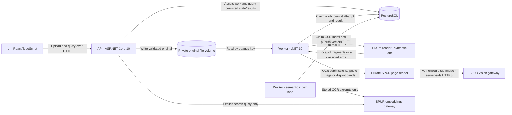

# HackthonSpurs · Track 2 architecture

**Scope: local, single-workspace demonstration with administrator and reader accounts.** A user uploads a document, leaves the UI, and comes back to see what could be read and **where it appears in the original**. Finishing a reading job does not establish that a claim is true or that a product complies with a regulation.

**Delivery status:** the .NET 10 API, PostgreSQL persistence, private original-file storage and the eight authenticated [document/search operations](api/openapi.json) are implemented. The React Documents screen uses these operations through a loopback Vite proxy. Products and Review queue still display separate demo data. The opt-in synthetic Worker profile processes one exact fixture through an internal test reader; ordinary uploads remain queued. A separate [SPUR reader](spur-ocr.md) can transcribe a caller-supplied page image using the hackathon vision model. The optional document Worker prepares PNG/JPEG inputs or renders submitted PDF/Office/text into page images. Pages that do not fit the reader budget may be split into non-overlapping bands; the UI displays the persisted transcription beside the upload form. Successful explicit OCR also schedules a separate durable semantic index job; the optional index worker writes pgvector chunks with page locators. No live OCR, live embeddings verification or data-transfer approval is implied. See the [local API runbook](../README.md) and [UI handoff](api/README.md).

The [backend resource catalog and error dictionary](backend-resources.md) is shared by all hosts. Safe OCR error codes survive the Worker boundary; historical generic failures are not rewritten.

## 1. System boundaries

Five target services: **React/TypeScript UI, ASP.NET Core API, .NET Worker, document reader/OCR and PostgreSQL**. The API accepts durable work; the Worker claims eligible jobs for its configured reader from PostgreSQL and calls the reader over HTTP. The reader returns evidence, not decisions. Original files belong on a private volume, not in a sixth service.



The browser will use only the same-origin API. There is no API-to-Worker HTTP call, browser callback, external provider in the default stack, or automatic corpus ingestion or legacy backfill. The reader must not receive database credentials or mount the original-file volume. Reading a result or checking index status never schedules work. The index worker has no originals mount.

## 2. Evidence driving the design

The [official repository](https://github.com/lokomurdok89/HackthonSpurs) was empty at the initial clone. Design inputs were the private ArenysMed architectural handoff (§§1, 3–7; static inspection, not a production attestation), the local Phase 1 report (§§3–8), its 193-entry document matrix and the participant FAQ. Case filenames, commercial records and originals are not reproduced here.

| Finding | Design consequence |
|---|---|
| Phase 1 identified 63 priority, 63 supporting and 67 out-of-scope files. Priority files include 43 PDFs and 9 spreadsheets. Eighteen PDFs had no text layer and one had only a digital footer. | Start with deliberate uploads of PDF and spreadsheet evidence. Choose native text or OCR per page; the existence of a text layer does not make the page readable. |
| CUSMA does not mandate a single certificate template; Annex 5-A covers minimum data elements. The case includes disputed classification and inputs of unknown origin. | Link values to evidence. Neither a supplier address nor the most recently read classification settles origin. No regional-content calculation or certification. [CUSMA Chapter 5 and Annex 5-A](https://www.international.gc.ca/trade-commerce/trade-agreements-accords-commerciaux/agr-acc/cusma-aceum/text-texte/05.aspx?lang=eng). |
| DPP obligations depend on product group and applicable law. A commercial request does not establish a legal obligation; environmental data for a batch does not prove allocation to an order. | Keep design, receipt and allocation evidence separate. Preserve conflicting claims; do not impose DPP fields, generate a QR code or publish a passport. [European Commission DPP FAQ](https://single-market-economy.ec.europa.eu/single-market/digital-product-passport/explore-our-faqs_en). |
| A website, certificate, invoice, bill of materials and receiving record can disagree. A photo may contain no readable text. | Report what was read, how and where. Do not infer material or origin from appearance. Future web evidence would need source and date; no crawler or following embedded links. |

### Format policy

| Observed format | Reading strategy and original locator | Scope |
|---|---|---|
| PDF (91) | Prefer useful native text; rasterize individual pages if needed. Preserve original page number, method and warnings. | Upload admitted. Future reader acceptance requires digital, scanned and mixed synthetic PDFs. |
| XLSX (27), CSV (3) | Native worksheet/cell range or one-based row/column. Do not recalculate formulas, execute macros or resolve links. Missing is not zero. | Upload admitted. Prioritize a synthetic materials sheet. |
| JPG (20), PNG (3) | OCR a label when needed; keep its source image. | Not enabled in the API. Consider after validating PDF reading. |
| DOCX (24), EML (18), EDI (4), TXT (2), ICS (1) | Future locators could be sections, message parts, exchange segments or lines; do not rasterize structured formats by default. | Deferred. Some DOCX/EML/EDI evidence is high priority: this demo is partial. Choose the next adapter by the question it answers. ICS is out of scope. |

Acceptance is not proof that the file is safe or fully readable. The reader must enforce its own limits and format allowlist. Only invented fixtures may enter public tests, logs or screenshots.

## 3. What transfers from ArenysMed

| Boundary | Verified in the reference | HackthonSpurs choice |
|---|---|---|
| Acceptance and queries | API saves the original, persists request plus outbox, returns 202 and exposes queries. | Keep durable acceptance, idempotency, hashing and separate read/write paths. New code and public contracts. |
| Async work | API outbox publisher → RabbitMQ → Worker with inbox, retries and dead-letter queue. | Replace this chain with one PostgreSQL job per document. A single producer and job type do not justify a broker. |
| OCR | In-process .NET port inside the Worker; local preparation, Google Document AI and a separate Vertex stage. No HTTP OCR server. | Keep the separate internal HTTP boundary. The test double is local; the intended real OCR is supplied by the hackathon, not Google. No cloud SDK, prompts, business rules or medical extraction contracts. |
| Persistence | Product state in PostgreSQL via EF Core/Npgsql; originals in a private store. MySQL is external and Redis belongs to n8n. | Keep metadata and binary storage separate. Choose PostgreSQL for atomic acceptance and job ownership, not because the reference used it. |
| Operations | DI/options, correlation, attempts, sanitized logs, health and synthetic tests. | Keep configuration, bounded operations, structured logs and real PostgreSQL tests. Omit clinical workflows, n8n, SISMED, third-party publication and a separate observability platform. |

PostgreSQL enforces uniqueness across API instances and enables short claim transactions without holding a lock throughout OCR. SQLite would require processes to coordinate a shared database file; an in-memory queue would lose work on restart; a broker would not remove the need to coordinate durable acceptance. Revisit if routing or measured latency warrants it. [PostgreSQL locking clauses and queue-like tables](https://www.postgresql.org/docs/18/sql-select.html#SQL-FOR-UPDATE-SHARE).

## 4. Projects and dependencies

The backend solution is [HackthonSpurs.slnx](../backend/HackthonSpurs.slnx). Project and folder names match. Folders group code by responsibility **inside** a project; a separate project is warranted here by a deployment boundary, a shared dependency or native process isolation.

| Project or build asset | Where to put a change | Why this boundary exists |
|---|---|---|
| [HackthonSpurs.Domain](../backend/HackthonSpurs.Domain) | Decisions independent of I/O: whether a submission is a replay and which changes to a workspace administrator are permitted. | Uses only the .NET base library. A domain policy is not an EF entity, worker or wire DTO. |
| [HackthonSpurs.Application](../backend/HackthonSpurs.Application) | Document commands, read projections and ports for processing a single claim. | Owns the contracts it needs. Use cases can run with test doubles and do not know about EF, PostgreSQL, HTTP hosts, Magick or the storage volume. |
| [HackthonSpurs.Api](../backend/HackthonSpurs.Api) | HTTP routes, authentication and authorization, safe HTTP failures, DI and startup. | An inbound adapter. It parses the public protocol and maps application outcomes to the same OpenAPI responses. The composition root selects adapters and applies EF migrations. |
| [HackthonSpurs.Documents](../backend/HackthonSpurs.Documents) | SQL/EF projections and transactional commands, persisted entities and mapping, private original storage, vector search and provider integration. | An outer adapter shared by the hosts. Its existing name and assembly identity are retained for published migrations. Do not add new business rules here just because their inputs are stored in this database. |
| [HackthonSpurs.Worker](../backend/HackthonSpurs.Worker) | Polling, leases in PostgreSQL, rendering and private reader transport, configuration and diagnostics. | The host adapts an independently testable processing step to a long-running service. The index lane has no original-file mount or OCR client. |
| [HackthonSpurs.Reader.Spur](../backend/HackthonSpurs.Reader.Spur) | Private page endpoint in `Endpoints/`, the transcription boundary in `Contracts/` and SPUR settings and HTTP adapter in `Provider/`. | The vision credential belongs to this HTTP service, not the document Worker or browser. No database or original-volume access. |
| [HackthonSpurs.Reader.Fixture](../backend/HackthonSpurs.Reader.Fixture) | The private synthetic reader and its exact CSV fixture. | Remains an executable for end-to-end tests of the HTTP boundary; no external provider or credential is needed. |
| [HackthonSpurs.Ocr.Bilevel](../backend/HackthonSpurs.Ocr.Bilevel) | Worker-side monochrome image encoding with Magick.NET. | This is a **child process**, not another network service. Its native package is shipped only in the document-OCR image; it can be terminated independently of the Worker. |
| [HackthonSpurs.Resources](../backend/HackthonSpurs.Resources) | Authored catalog, generated bindings, bounded OCR payload helpers. | Readers, Worker and API share stable constants and limits without importing EF, provider implementations or another host. |
| [Infrastructure/PostgresVector](../backend/Infrastructure/PostgresVector) | PostgreSQL image build and extension initialization SQL. | A Docker build asset, not a .NET project. Document schema changes still belong to EF migrations. |

The fixture reader and the image helper each have a single implementation beside their entry point. They do not need the API’s folder hierarchy. Conversely, entities (stored state) and request/response shapes (transport contracts) do not belong in one global `Models` library.

**Dependency direction (compile time, not network traffic):**

```text
API and Worker composition roots ──► application use cases + concrete adapters
Document / queue / provider adapters ──► application-owned ports
Application ──► Domain
```

Resources supplies the shared protocol vocabulary and operational constants; it does not depend on a host. ASP.NET authentication, EF mappings, Npgsql leases and native image libraries are outer-layer concerns. There is no dependency from Domain or Application to a host or adapter. Run `python -B tests/quality/test_backend_layout.py` to check project references, package boundaries and document endpoints.

**Compatibility rule:** the physical folders for entities are not their EF identities. Their existing CLR namespace, Documents assembly, migration IDs and snapshot are deliberately preserved. This reorganization does not require a database migration or a new OpenAPI version. Compose service names, environment variables and HTTP routes are runtime contracts; do not rename them to match a source folder.

The [semantic search runbook](semantic-search.md) describes the optional index worker lane, the shared server-only vector profile, and provider isolation. The pgvector integration reuses the Npgsql connection and original PR #7 vector schema without text extraction or a parallel ingestion API.

### CQRS in the document backend

Commands and queries use the **same** PostgreSQL database. The distinction is the right to change state, not the HTTP verb or the number of databases.

| Operation | Owner of the decision | Boundary that must remain intact |
|---|---|---|
| Accept a staged upload | Application uses the domain replay policy: the same key, bytes and reading mode return the original receipt. A different payload or mode is a conflict. | The persistence adapter arbitrates simultaneous writers with the unique key, publishes the original and commits the job. It must not delete a published original on an ambiguous commit. Reading the winning row is part of this **command**. |
| Inspect a receipt, result, index, chunks or statistics | Read-only application contracts return projections rather than EF entities. | Polling does not enqueue work. Semantic search is also a **query** despite using POST and embedding the explicit search text: it must not write to the receipt, index or chunks. |
| Reindex a transcript | An explicit administrator **command**, independent of document admission. | Queues embeddings from stored OCR; never reopens the original, schedules OCR or changes the reading job. |
| Process one OCR or index claim | Application orchestration delegates reading/embedding and publication through narrow ports. | A claim is a write. PostgreSQL must check lease ownership when publishing; a stale worker cannot overwrite a later attempt. Polling, SQL, provider transport and shutdown stay outside domain policy. |
| Maintain workspace accounts | Listing accounts is a query. Creation, edits and session revocation mutate state. The self-lockout and last-admin rules are domain decisions. | The adapter checks the acting session and administrator count under the same writer lock as the update. Authentication cookies, password hashing and bootstrap remain operational concerns, not domain objects. |

For example, the [admission handler](../backend/HackthonSpurs.Application/Commands/AcceptDocumentHandler.cs) looks up the operation key *before* inspecting a staged original. A matching retry returns immediately. For a previously unseen key the [PostgreSQL adapter](../backend/HackthonSpurs.Documents/Persistence/Commands/PostgresDocumentAdmissions.cs) reserves the key inside a transaction; if a concurrent writer won, it returns that writer's identity to the **same** domain replay rule. This keeps race handling in the adapter without duplicating the admission rule. A filesystem move is not a PostgreSQL transaction: an ambiguous commit can leave an orphan, so the adapter must not guess that it is safe to delete.

For a new read projection, start with the fields and read-only port in [Application/Queries](../backend/HackthonSpurs.Application/Queries); implement it as a no-tracking projection in [Persistence/Queries](../backend/HackthonSpurs.Documents/Persistence/Queries). Add a separate application handler only when there is orchestration (for example, checking index compatibility **before** embedding a search query). A pass-through handler or a shared `SaveChanges` method on read ports adds no value.

For Worker changes, start at [one reading attempt](../backend/HackthonSpurs.Application/Processing/ProcessReadingJob.cs) or [one index attempt](../backend/HackthonSpurs.Application/Processing/ProcessIndexJob.cs). Run `dotnet run --project tests/application -c Release` to exercise the decisions with in-memory ports. The [semantic integration suite](../tests/integration/test_semantic_index.py) separately checks real PostgreSQL row versions around all six read operations and counts private reader calls through replay and reindex.

**Why these interfaces?** Use a port where an external effect needs substituting, where a query must not obtain write capabilities, or where a transaction must remain indivisible. There is no generic repository, event bus, second database, or interface per class. EF entities remain persistence models; duplicating every column into an equivalent domain entity would not make any rule more independent.

## 5. Processing flow and contracts

1. **Upload.** One multipart file and a client-generated UUID operation key per submission. Never trust the filename, and never use it as a path. Enforce a byte cap while streaming, check file content and reject an incompatible declared type. An intentionally repeated submission with a new key is new work.
2. **Accept.** Write a unique temporary file in the private store, hash its bytes, validate and reserve the operation key in PostgreSQL. Atomically move the file into place before committing metadata and the queued job. Return `202 Accepted`, an ID and a relative `Location` **only after commit**. A unique index arbitrates competing API instances; a replay returns the winning ID even with a different filename. Different bytes under an accepted key yield 409.
3. **Claim.** The fixture Worker selects only the known CSV; the optional SPUR Worker selects the persisted OCR mode, never an original merely because its type matches. Each claims a job in a short transaction, increments its attempt and sets an expiring lease/token. Read the original by its opaque ID and verify the hash. Do not hold a database transaction while reading or calling OCR.
4. **Read.** Internal `POST /internal/read` takes bounded bytes, media type, correlation and contract version, not arbitrary paths or URLs. Return located fragments, method and warnings or a classified error. No direct reader access to SQL. Do not invent confidence values or finalize business extraction fields here.
5. **Persist and query.** Each Worker validates result identity, version, bounds and its expected locator, and commits result plus terminal state only for the current lease owner. The API already queries persisted state and results without side effects; see the [wire contract](api/openapi.json) for exact casing, errors and examples. UI must render extracted text as untrusted plain text.

6. **Index and search (optional).** The OCR publication commits one index row in the same statement. Zero readable text commits `Skipped`; otherwise a separate worker claims the row, sends bounded OCR excerpts to SPUR embeddings, and commits one vector generation while its lease is valid. Chunks preserve the original printed page. The independent outcomes do not change the transcript. Only newly published OCR-mode results are eligible. Searching compares current-profile vectors and returns cited excerpts.

### 5.1 First demo: from a bill of materials to a supplier certificate

**User question:** “Does this certificate correspond to the bushing in my materials sheet, and what does it establish about origin?” These are separate questions.

**Synthetic inputs:** row 12 in worksheet `Materiales` names bushing `CAS-014` and cites `CERT-027`. The one-page certificate shows both IDs, a material grade and a Canadian supplier address. In the baseline sample the entire page is legible but contains no origin statement. Keep the original worksheet name in locators.

Upload the two files independently. The future Worker/reader will return the worksheet cells and page-1 fragments, using OCR only if necessary. The UI will let the reviewer compare **Materiales · row 12** and **Certificate · page 1**. The comparison is human-assisted, not automatic association or a rule engine.

| Synthetic variant | What the reviewer should see | Next action and limit |
|---|---|---|
| Only the supplier matches; the certificate and part IDs cannot be corroborated. | **Link unconfirmed.** Present the candidate PDF and the row without treating it as evidence for this part. | Find the cited certificate or supporting reference. Do not evaluate origin from an unconfirmed link. |
| Both IDs match; the complete, legible certificate states a grade and supplier address, not origin. | **Origin not demonstrated by this certificate.** Show the identifiers and page supporting the grade. Never report Canada as origin, “non-originating” or “not CUSMA-compliant.” | Request origin evidence for this part and, where applicable, its lot. Repeating OCR cannot supply missing evidence. |
| IDs match, but the origin section of the scan is cropped or blurred. | **The origin section could not be read; inspect page 1.** Preserve the verified link and flag the original page. Do not say the certificate contains no origin statement. | Inspect the original or obtain a legible copy. Do not infer the missing text. |

In all three cases, `Completed` refers to the reading job, not the strength of the evidence. A valid partial reading may contain a localized warning. None of these evidence outcomes, by itself, is a failure or reason to retry.

## 6. Persistence, states and failure boundaries

The current migration creates one `document_jobs` row per document: operation key, opaque ID (also the storage key), hash, media type, byte count, acceptance time, state, attempt, optional terminal failure code and optional JSONB reading. A unique index protects the operation key; check constraints tie the presence of the result to `Completed` and the failure code to `Failed`. Public endpoints do not set terminal states. The DocumentOcrRouting migration records the requested mode; only legacy images are backfilled as OCR. The additive WorkerLeases migration adds nullable ownership token, expiry and next-attempt time. Attempts are counted on the job; there is no separate history table. See the [fixture contract](reader-fixture.md). The additive DurableDocumentIndex migration preserves the upstream vector table and adds each vector's optional page plus the independent leased job table. Older vectors cannot be searched without a completed compatible job.

| Event | State and behavior |
|---|---|
| Acceptance committed | `Queued`, attempt 0. The UI may leave. The API never acknowledges a failed save. |
| Claim (eligible jobs only) | `Queued → Processing`; select eligible rows in a stable order with `SKIP LOCKED`, commit the lease, then perform I/O. One active job is sufficient initially. |
| Timeout or temporary reader outage (fixture) | `Processing → Queued` with next eligible time. Three attempts total, delays of 5 s and 30 s. Do not stack another automatic HTTP retry policy. |
| Timeout, outage or expired lease (SPUR) | Fail after the single claim. Do not automatically resend a possibly billed image. |
| Worker exits unexpectedly | Reclaim expired leases using database time, or fail an exhausted job. An expired owner cannot publish a late result or overwrite a subsequent attempt. |
| Permanent error or attempt limit | `Failed` plus a safe failure code. The status endpoint returns 200; result lookup returns 409 with `processing_failed`. Pending results use `result_not_ready`. |
| Successful or partial reading | Atomically publish `Completed` and the technical result. Preserve page/cell locators and warnings rather than inventing content. |

Fixture processing can be repeated. External OCR has at most one application-level attempt per job, not an exactly-once guarantee. Keep one current result; bound the reader timeout below the lease duration with time left to validate and save. Keep per-attempt diagnostics out of public result payloads.

**Files and SQL are not one transaction.** The API removes its own temporary files on normal exits and rollback paths. A crash can leave an old temporary file or a published original without a committed row. Never delete a published file after an ambiguous commit acknowledgement: replay the same key to resolve the operation. Reconcile aged orphans against committed metadata manually; do not bulk-delete the volume or source corpus.

## 7. Local execution and data control

- **Today:** Default Compose runs PostgreSQL and the API; the synthetic profile adds the Worker and fixture reader. Only the API is mapped to host loopback for UI integration. The database is internal. The local Vite dev server proxies browser requests to the loopback API; the Worker and reader should stay private. The [workspace access boundary](workspace-access.md) uses local accounts, revocable sessions and server-enforced roles. All readers share the same document scope. Do not expose remotely without TLS, deployment hardening and an appropriate per-document authorization model.
- **Persistence:** use separate named volumes for the database and original files. The API writes originals; the Worker mounts them read-only. The reader should only have bounded, ephemeral temporary space. Never put the challenge folder in an image, container mount or build context. Restarts preserve both volumes.
- **Startup:** Compose waits for PostgreSQL health; only the API migrates. The Worker retries its claim if the API has not finished migrating. A future real reader will need engine readiness checks. API acceptance should stay available during a reader outage if storage and SQL are reachable. Liveness is not proof of processing readiness.
- **Configuration:** connection settings, private absolute storage path and upload cap are configured per host. The fixture endpoint is internal; polling, retries, timeouts and lease duration are bounded as documented in the fixture contract. The reader must bound pages, cells, pixels, archive expansion, execution time and output size. Run containers without unnecessary privileges, limit reader memory/CPU, and keep credentials out of Git and the browser bundle.
- **Privacy:** use opaque IDs, duration, outcome and safe error codes for diagnostics. Never log or publish original names, text, workbook rows, private payloads or secrets. Use invented fixtures, not renamed originals. Demo retention is separate from legal retention obligations for a real evidence file.

## 8. Delivery order and review

1. **API foundation (this slice):** build and run the two-service stack; accept durable uploads, handle duplicate/concurrent operations, return status and persisted results. Verify restart, database outage and read-only endpoints with invented inputs.
2. **Worker and internal reader contract:** demonstrate claim → read → validated atomic publication with a synthetic reader; test interruption, expired leases, late responses and the attempt limit.
3. **Real reading (pending provider documentation and authorization):** digital, scanned and mixed PDFs, then XLSX/CSV. A digital footer must not hide a scanned page, and a blank cell must not become zero.
4. **UI and evidence demo:** show all three §5.1 outcomes with the original locator visible. Verify recovery after closing the UI. Do not confuse infrastructure failure with insufficient evidence.
5. **Before sharing:** review scope, third-party licenses and attribution. Publish only synthetic fixtures. No automated certificate issuance, passport or eligibility decision.

**Open decisions:** Which languages, limits and response times can the demo machine support on authorized samples? Does the team confirm a single-machine demo with no remote access or external providers? Changes to that boundary require a new security review.

**Reuse:** ArenysMed supplied architectural knowledge, not code, prompts, data, migrations or runtime configuration. Follow the [official hackathon rules](https://kdubhacks.com/rules): build the core during the event, disclose pre-existing work and do not publish event data. CUSMA business logic, final extraction schemas, DPP implementation and Track 3 remain out of scope.
