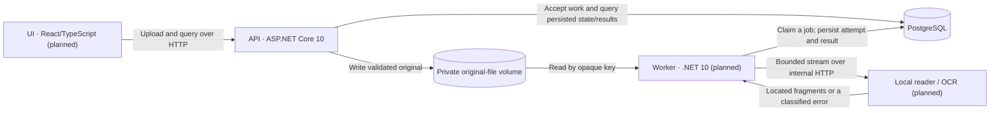

# HackthonSpurs · Track 2 architecture

**Scope: local, single-user demonstration.** A user uploads a document, leaves the UI, and comes back to see what could be read and **where it appears in the original**. Finishing a reading job does not establish that a claim is true or that a product complies with a regulation.

**Delivery status:** the .NET 10 API, PostgreSQL persistence, private original-file storage and the three [public operations](api/openapi.json) are implemented. The Worker, reader/OCR and UI are still planned. New uploads remain queued until a Worker exists. Tests use synthetic persisted results to exercise the public reads, not a substitute OCR service. See the [local API runbook](../README.md) and [UI handoff](api/README.md).

## 1. System boundaries

Five target services: **React/TypeScript UI, ASP.NET Core API, .NET Worker, document reader/OCR and PostgreSQL**. The API accepts durable work; the Worker will claim it from PostgreSQL and call the reader over HTTP. The reader returns evidence, not decisions. Original files belong on a private volume, not in a sixth service.

The browser will use only the same-origin API. There is no API-to-Worker HTTP call, browser callback, cloud provider or automatic corpus ingestion. The reader must not receive database credentials or mount the original-file volume. Reading a result never schedules work.

## 2. Evidence driving the design

The [official repository](https://github.com/lokomurdok89/HackthonSpurs) was empty at the initial clone. Design inputs were the private ArenysMed architectural handoff (§§1, 3–7; static inspection, not a production attestation), the local Phase 1 report (§§3–8), its 193-entry document matrix and the participant FAQ. Case filenames, commercial records and originals are not reproduced here.

| Finding | Design consequence |
|---|---|
| Phase 1 identified 63 priority, 63 supporting and 67 out-of-scope files. Priority files include 43 PDFs and 9 spreadsheets. Eighteen PDFs had no text layer and one had only a digital footer. | Start with deliberate uploads of PDF and spreadsheet evidence. Choose native text or OCR per page; the existence of a text layer does not make the page readable. |
| CUSMA does not mandate a single certificate template; Annex 5-A covers minimum data elements. The case includes disputed classification and inputs of unknown origin. | Link values to evidence. Neither a supplier address nor the most recently read classification settles origin. No regional-content calculation or certification. [CUSMA Chapter 5 and Annex 5-A](https://www.international.gc.ca/trade-commerce/trade-agreements-accords-commerciaux/agr-acc/cusma-aceum/text-texte/05.aspx?lang=eng). |
| DPP obligations depend on product group and applicable law. A commercial request does not establish a legal obligation; environmental data for a batch does not prove allocation to an order. | Keep design, receipt and allocation evidence separate. Preserve conflicting claims; do not impose DPP fields, generate a QR code or publish a passport. [European Commission DPP FAQ](https://single-market-economy.ec.europa.eu/single-market/digital-product-passport/explore-our-faqs_en). |
| A website, certificate, invoice, bill of materials and receiving record can disagree. A photo may contain no readable text. | Report what was read, how and where. Do not infer material or origin from appearance. Future web evidence would need source and date; no crawler or following embedded links. |

### Format policy

| Observed format | Reading strategy and original locator | Scope |
|---|---|---|
| PDF (91) | Prefer useful native text; rasterize individual pages if needed. Preserve original page number, method and warnings. | Upload admitted. Future reader acceptance requires digital, scanned and mixed synthetic PDFs. |
| XLSX (27), CSV (3) | Native worksheet/cell range or one-based row/column. Do not recalculate formulas, execute macros or resolve links. Missing is not zero. | Upload admitted. Prioritize a synthetic materials sheet. |
| JPG (20), PNG (3) | OCR a label when needed; keep its source image. | Not enabled in the API. Consider after validating PDF reading. |
| DOCX (24), EML (18), EDI (4), TXT (2), ICS (1) | Future locators could be sections, message parts, exchange segments or lines; do not rasterize structured formats by default. | Deferred. Some DOCX/EML/EDI evidence is high priority: this demo is partial. Choose the next adapter by the question it answers. ICS is out of scope. |

Acceptance is not proof that the file is safe or fully readable. The reader must enforce its own limits and format allowlist. Only invented fixtures may enter public tests, logs or screenshots.

## 3. What transfers from ArenysMed

| Boundary | Verified in the reference | HackthonSpurs choice |
|---|---|---|
| Acceptance and queries | API saves the original, persists request plus outbox, returns 202 and exposes queries. | Keep durable acceptance, idempotency, hashing and separate read/write paths. New code and public contracts. |
| Async work | API outbox publisher → RabbitMQ → Worker with inbox, retries and dead-letter queue. | Replace this chain with one PostgreSQL job per document. A single producer and job type do not justify a broker. |
| OCR | In-process .NET port inside the Worker; local preparation, Google Document AI and a separate Vertex stage. No HTTP OCR server. | Plan a separate internal HTTP process for native reading and OCR. No cloud SDK, prompts, business rules or medical extraction contracts. |
| Persistence | Product state in PostgreSQL via EF Core/Npgsql; originals in a private store. MySQL is external and Redis belongs to n8n. | Keep metadata and binary storage separate. Choose PostgreSQL for atomic acceptance and job ownership, not because the reference used it. |
| Operations | DI/options, correlation, attempts, sanitized logs, health and synthetic tests. | Keep configuration, bounded operations, structured logs and real PostgreSQL tests. Omit clinical workflows, n8n, SISMED, third-party publication and a separate observability platform. |

PostgreSQL enforces uniqueness across API instances and enables short claim transactions without holding a lock throughout OCR. SQLite would require processes to coordinate a shared database file; an in-memory queue would lose work on restart; a broker would not remove the need to coordinate durable acceptance. Revisit if routing or measured latency warrants it. [PostgreSQL locking clauses and queue-like tables](https://www.postgresql.org/docs/18/sql-select.html#SQL-FOR-UPDATE-SHARE).

## 4. Projects and dependencies

| Component | Responsibility |
|---|---|
| `backend/HackthonSpurs.Api/` | ASP.NET Core 10 host, request validation, multipart streaming, config/DI, safe HTTP errors and queries. Owns EF migrations at startup. |
| `backend/HackthonSpurs.Documents/` | Shared .NET library for ingestion, private original-file storage, file type admission, EF Core/Npgsql mapping and migrations. No dependency on the UI or OCR. |
| `tests/contract/`, `tests/integration/` | Offline OpenAPI examples and real HTTP/PostgreSQL acceptance tests, respectively. |
| `frontend/` | React, TypeScript, Vite and fetch. Upload form, status and evidence views. Same-origin proxy; no global state manager or WebSockets required. |
| `backend/HackthonSpurs.Worker/` (planned) | .NET BackgroundService, database claims, bounded retries and an HTTP reader client. References Documents, not the API host. |
| `backend/reader/` (planned) | Local Python/FastAPI/Uvicorn service. Evaluate Poppler for PDF text/rasterization, Tesseract for OCR, openpyxl for spreadsheets and the standard CSV library. No LLM required. |

The backend solution is `backend/HackthonSpurs.slnx`. EF Core with its PostgreSQL provider owns storage and migrations; BCL and ASP.NET Core handle streaming, hashing, ZIP/XML inspection, configuration and HTTP. Pin reader binaries, languages and licenses when that service is added.

## 5. Processing flow and contracts

1. **Upload.** One multipart file and a client-generated UUID operation key per submission. Never trust the filename, and never use it as a path. Enforce a byte cap while streaming, check file content and reject an incompatible declared type. An intentionally repeated submission with a new key is new work.
2. **Accept.** Write a unique temporary file in the private store, hash its bytes, validate and reserve the operation key in PostgreSQL. Atomically move the file into place before committing metadata and the queued job. Return `202 Accepted`, an ID and a relative `Location` **only after commit**. A unique index arbitrates competing API instances; a replay returns the winning ID even with a different filename. Different bytes under an accepted key yield 409.
3. **Claim (planned).** The Worker will claim an eligible job in a short transaction, increment its attempt and set an expiring lease/token. Read the original by its opaque ID and verify the hash. Do not hold a database transaction while reading or calling OCR.
4. **Read (planned).** Internal `POST /internal/read` will take bounded bytes, media type, correlation and contract version, not arbitrary paths or URLs. Return located fragments, method and warnings or a classified error. No direct reader access to SQL. Do not invent confidence values or finalize business extraction fields here.
5. **Persist and query.** Worker publication must validate result identity, version, bounds and locators, and commit result plus terminal state only for the current lease owner. The API already queries persisted state and results without side effects; see the [wire contract](api/openapi.json) for exact casing, errors and examples. UI must render extracted text as untrusted plain text.

### 5.1 First demo: from a bill of materials to a supplier certificate

**User question:** “Does this certificate correspond to the bushing in my materials sheet, and what does it establish about origin?” These are separate questions.

**Synthetic inputs:** row 12 in worksheet `Materiales` names bushing `CAS-014` and cites `CERT-027`. The one-page certificate shows both IDs, a material grade and a Canadian supplier address. In the baseline sample the entire page is legible but contains no origin statement. Keep the original worksheet name in locators.

Upload the two files independently. The future Worker/reader will return the worksheet cells and page-1 fragments, using OCR only if necessary. The UI will let the reviewer compare **Materiales · row 12** and **Certificate · page 1**. The comparison is human-assisted, not automatic association or a rule engine.

| Synthetic variant | What the reviewer should see | Next action and limit |
|---|---|---|
| Only the supplier matches; the certificate and part IDs cannot be corroborated. | **Link unconfirmed.** Present the candidate PDF and the row without treating it as evidence for this part. | Find the cited certificate or supporting reference. Do not evaluate origin from an unconfirmed link. |
| Both IDs match; the complete, legible certificate states a grade and supplier address, not origin. | **Origin not demonstrated by this certificate.** Show the identifiers and page supporting the grade. Never report Canada as origin, “non-originating” or “not CUSMA-compliant.” | Request origin evidence for this part and, where applicable, its lot. Repeating OCR cannot supply missing evidence. |
| IDs match, but the origin section of the scan is cropped or blurred. | **The origin section could not be read; inspect page 1.** Preserve the verified link and flag the original page. Do not say the certificate contains no origin statement. | Inspect the original or obtain a legible copy. Do not infer the missing text. |

In all three cases, `Completed` refers to the reading job, not the strength of the evidence. A valid partial reading may contain a localized warning. None of these evidence outcomes, by itself, is a failure or reason to retry.

## 6. Persistence, states and failure boundaries

The current migration creates one `document_jobs` row per document: operation key, opaque ID (also the storage key), hash, media type, byte count, acceptance time, state, attempt, optional terminal failure code and optional JSONB reading. A unique index protects the operation key; check constraints tie the presence of the result to `Completed` and the failure code to `Failed`. The three public endpoints do not set terminal states. Worker lease, scheduling and attempt-history fields belong to the next migration, not this delivery.

| Event | State and behavior |
|---|---|
| Acceptance committed | `Queued`, attempt 0. The UI may leave. The API never acknowledges a failed save. |
| Claim (planned) | `Queued → Processing`; select eligible rows in a stable order with `SKIP LOCKED`, commit the lease, then perform I/O. One active job is sufficient initially. |
| Timeout or temporary reader outage (planned) | `Processing → Queued` with next eligible time. Initial proposal: three attempts total, delays of 5 s and 30 s. Do not stack another automatic HTTP retry policy. |
| Worker exits unexpectedly (planned) | Reclaim expired leases using database time, or fail an exhausted job. An expired owner cannot publish a late result or overwrite a subsequent attempt. |
| Permanent error or attempt limit | `Failed` plus a safe failure code. The status endpoint returns 200; result lookup returns 409 with `processing_failed`. Pending results use `result_not_ready`. |
| Successful or partial reading | Atomically publish `Completed` and the technical result. Preserve page/cell locators and warnings rather than inventing content. |

The target is at-least-once execution, not exactly-once OCR. Keep one current result; bound the reader timeout below the lease duration with time left to validate and save. Keep per-attempt diagnostics out of public result payloads.

**Files and SQL are not one transaction.** The API removes its own temporary files on normal exits and rollback paths. A crash can leave an old temporary file or a published original without a committed row. Never delete a published file after an ambiguous commit acknowledgement: replay the same key to resolve the operation. Reconcile aged orphans against committed metadata manually; do not bulk-delete the volume or source corpus.

## 7. Local execution and data control

- **Today:** Compose runs PostgreSQL and the API. Only the API is mapped to host loopback for UI integration. The database is internal. When the UI proxy arrives it should become the only exposed service; the Worker and reader should stay private. This demo has no authentication: exposing it remotely requires authentication, per-document authorization and TLS first.
- **Persistence:** use separate named volumes for the database and original files. The API writes originals; the future Worker should mount them read-only. The reader should only have bounded, ephemeral temporary space. Never put the challenge folder in an image, container mount or build context. Restarts preserve both volumes.
- **Startup:** Compose waits for PostgreSQL health; only the API migrates. A future Worker waits for the schema and a future reader reports engine/language readiness. API acceptance should stay available during a reader outage if storage and SQL are reachable. Liveness is not proof of processing readiness.
- **Configuration:** connection settings, private absolute storage path and upload cap are configured per host. Worker-specific endpoint, polling, retries, timeouts and leases are planned. The reader must bound pages, cells, pixels, archive expansion, execution time and output size. Run containers without unnecessary privileges, limit reader memory/CPU, and keep credentials out of Git and the browser bundle.
- **Privacy:** use opaque IDs, duration, outcome and safe error codes for diagnostics. Never log or publish original names, text, workbook rows, private payloads or secrets. Use invented fixtures, not renamed originals. Demo retention is separate from legal retention obligations for a real evidence file.

## 8. Delivery order and review

1. **API foundation (this slice):** build and run the two-service stack; accept durable uploads, handle duplicate/concurrent operations, return status and persisted results. Verify restart, database outage and read-only endpoints with invented inputs.
2. **Worker and internal reader contract:** demonstrate claim → read → validated atomic publication with a synthetic reader; test interruption, expired leases, late responses and the attempt limit.
3. **Real local reading:** digital, scanned and mixed PDFs, then XLSX/CSV. A digital footer must not hide a scanned page, and a blank cell must not become zero.
4. **UI and evidence demo:** show all three §5.1 outcomes with the original locator visible. Verify recovery after closing the UI. Do not confuse infrastructure failure with insufficient evidence.
5. **Before sharing:** review scope, third-party licenses and attribution. Publish only synthetic fixtures. No automated certificate issuance, passport or eligibility decision.

**Open decisions:** Which languages, limits and response times can the demo machine support on authorized samples? Does the team confirm a single-machine demo with no remote access or external providers? Changes to that boundary require a new security review.

**Reuse:** ArenysMed supplied architectural knowledge, not code, prompts, data, migrations or runtime configuration. Follow the [official hackathon rules](https://kdubhacks.com/rules): build the core during the event, disclose pre-existing work and do not publish event data. CUSMA business logic, final extraction schemas, DPP implementation and Track 3 remain out of scope.
