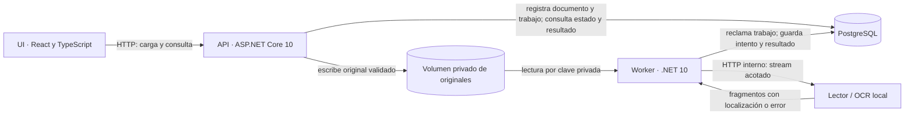

# HackthonSpurs · Arquitectura base del Track 2

**Propuesta para revisión · 27 de noviembre de 2026 · Sin implementación.** El primer recorrido debe permitir subir un archivo de prueba, cerrar la UI, volver más tarde y ver qué se pudo leer y **en qué página o celda**. Que el procesamiento termine no significa que el dato sea verdadero ni que el producto cumpla una norma.

## 1. Arquitectura propuesta

Cinco servicios locales: **UI React/TypeScript, API ASP.NET Core 10, Worker .NET 10, lector/OCR y PostgreSQL**. La API acepta trabajo durable; el Worker lo reclama en la base y llama al lector por HTTP. El lector devuelve evidencia, no decisiones. Los originales se guardan en un volumen privado de Docker: es almacenamiento, **no un sexto servicio**.



El navegador sólo conoce la API a través del mismo origen que sirve la UI. **No** hay llamada API → Worker, callback a la UI, proveedor cloud ni carga del corpus al arrancar. El lector no recibe credenciales de base ni acceso al volumen de originales. Para ver un resultado, la UI consulta a la API; recargar la página no lanza otro trabajo.

## 2. Evidencia que determina el diseño

**Punto de partida.** El [repositorio oficial](https://github.com/lokomurdok89/HackthonSpurs) no tenía commits ni estructura previa al clonado. Se leyó el handoff privado de ArenysMed, en particular sus secciones 1 y 3–7: es una inspección estática del árbol de trabajo del origen, no una certificación de producción. Se contrastaron el informe local de fase 1 (§§ 3–8), su matriz de 193 entradas y la FAQ de participantes. No se incorporan aquí nombres de archivos del caso, datos comerciales ni copias de esos insumos.

| Hallazgo confirmado | Consecuencia arquitectónica |
|---|---|
| La matriz distingue 63 archivos prioritarios, 63 complementarios y 67 fuera de alcance. Entre los prioritarios hay 43 PDF y 9 XLSX. La fase 1 encontró 18 PDF sin capa de texto y un PDF cuya capa contiene sólo un pie. | Priorizar **PDF y hojas de cálculo**, no un OCR universal. Decidir si hay texto útil por página, no sólo por la existencia de texto en el archivo. Empezar con carga deliberada, no indexación masiva. |
| En CUSMA, una certificación no exige una plantilla única; el anexo 5-A distingue elementos mínimos y el capítulo 5 trata la documentación de respaldo. La fase 1 encontró clasificación discutida y origen de insumos sin demostrar. | Un valor extraído debe apuntar a su fuente. No sustituir «desconocido» por país del proveedor, ni una clasificación controvertida por el último valor leído. No se calcula contenido regional ni se emite certificación. [CUSMA, capítulo 5 y anexo 5-A](https://www.international.gc.ca/trade-commerce/trade-agreements-accords-commerciaux/agr-acc/cusma-aceum/text-texte/05.aspx?lang=eng). |
| Los requisitos de DPP dependen del grupo de producto y la norma aplicable. En el caso analizado, la petición comercial no prueba por sí misma una obligación legal; la evidencia ambiental por lote no demuestra la asignación a un pedido. | Mantener por separado evidencia de diseño, recepción y asignación efectiva. Conservar fuentes contradictorias sin fusionarlas ni elevar una declaración comercial a dato verificado. No imponer campos DPP, generar QR ni publicar un pasaporte. [Comisión Europea: alcance y granularidad del DPP](https://single-market-economy.ec.europa.eu/single-market/digital-product-passport/explore-our-faqs_en). |
| Web del fabricante, certificado, factura, lista de materiales y documento de recepción pueden afirmar cosas distintas. Una fotografía puede no contener texto ni permitir identificar un material. | El resultado técnico indica qué se leyó, cómo y dónde. Una lectura incompleta o sin evidencia se presenta como tal. Si se incorpora una fuente web en otra fase, conservar referencia y fecha; no incluir crawler ni activar enlaces embebidos. |

### Política de formatos del primer recorrido

| Formato observado | Ruta recomendada y localizador | Alcance |
|---|---|---|
| PDF (91) | Extraer texto nativo por página; si falta o sólo hay contenido marginal, rasterizar esa página y probar OCR. Mantener número de página del **original** y método usado. Informar páginas ambiguas. | Primera entrega vertical: un PDF digital y un escaneo sintéticos. Incluir un caso mixto antes de dar por concluido el lector. |
| XLSX (27), CSV (3) | Lectura nativa; hoja y celda/rango, o fila y columna. No recalcular fórmulas, ejecutar macros ni resolver enlaces; distinguir valor ausente de cero. | Incluir una hoja de materiales sintética. CSV aprovecha la biblioteca estándar. |
| JPG (20), PNG (3) | OCR si se pretende transcribir una etiqueta, con referencia a la imagen; no deducir origen o material por apariencia. | Ampliación de bajo coste tras validar el recorrido PDF. Formato no habilitado: rechazo explícito. |
| DOCX (24), EML (18), EDI (4), TXT (2), ICS (1) | La vía correcta sería texto/tablas por sección, partes del mensaje, segmentos de intercambio o líneas; no rasterizar estos archivos por defecto. | Aplazar. Hay evidencia prioritaria en DOCX, EML y EDI: la demo será **parcial**. Elegir el siguiente adaptador según la pregunta que deba responder, no por número de archivos. ICS queda fuera del recorrido inicial. |

No se admiten formatos por el mero hecho de aparecer en la matriz. La lista habilitada será la misma en API y lector. Ni el informe privado, ni los textos OCR, ni capturas derivadas del corpus son material para pruebas públicas.

## 3. Qué tomamos de ArenysMed y qué cambiamos

| Tema | Verificado en el handoff | Decisión para HackthonSpurs |
|---|---|---|
| Aceptación y consultas | La API valida, guarda el original, persiste solicitud y outbox, devuelve 202; hay endpoints de consulta. | **Conservar** la aceptación durable, idempotencia, hash y separación entre comandos y consultas. Reescribir los contratos. |
| Asincronía | Publicador en la API → RabbitMQ → Worker, con inbox, reintentos y cola de fallidos. | **Sustituir** ese recorrido por una tabla de trabajo en PostgreSQL: un productor, un tipo de tarea y un Worker. Mantener recuperación tras caídas sin operar otro servicio. |
| OCR | Puerto .NET dentro del Worker; puede usar preparación local y Google Document AI. Vertex es otra etapa. No hay servidor HTTP OCR. | **Cambiar la frontera:** un proceso HTTP local e independiente, tanto para lectura nativa como OCR. No portar SDK cloud, prompts, reglas de extracción ni contratos médicos. |
| Persistencia | PostgreSQL con EF Core/Npgsql para el producto; originales en almacenamiento privado. MySQL es una integración externa y Redis sirve a n8n. | **Conservar** la separación metadatos/binarios. Evaluar PostgreSQL por las transacciones que necesita el nuevo sistema, no por herencia. |
| Operación y pruebas | Options/DI, identidades de correlación, intentos, logs sanitizados, health y pruebas sintéticas. | **Conservar el mínimo**: configuración validada por host, logging estructurado, prueba con PostgreSQL real y muestras inventadas. No trasladar n8n, SISMED, gestión clínica, publicación a terceros, historial de pipelines ni plataforma de observabilidad. |

**Elección de base de datos.** Se propone PostgreSQL porque permite confirmar documento y trabajo en una transacción, imponer unicidad y reclamar una fila sin retener un bloqueo durante el OCR. SQLite reduciría un contenedor, pero obligaría a API y Worker a compartir y coordinar un archivo de base. Una cola en memoria perdería trabajo al reiniciar; un broker conservaría entregas, pero no eliminaría la necesidad de persistir resultados ni de coordinar la aceptación. Para este volumen, el coste aceptado es un contenedor y un sondeo periódico. Revisar sólo si aparecen varios consumidores con rutas distintas o la latencia medida lo exige. [PostgreSQL: bloqueo de filas y uso de SKIP LOCKED en colas](https://www.postgresql.org/docs/18/sql-select.html#SQL-FOR-UPDATE-SHARE).

## 4. Proyectos y dependencias mínimas

Árbol **futuro**; en esta fase sólo se crea este documento. Los directorios de código no son servicios adicionales.

```text
docs/ARCHITECTURE.md
HackthonSpurs.slnx
src/
  web/                       React + TypeScript; carga, estado, evidencia
  HackthonSpurs.Api/         ASP.NET Core 10; validación HTTP, ingesta y consultas
  HackthonSpurs.Worker/      .NET 10 BackgroundService; cola y cliente HTTP del lector
  HackthonSpurs.Documents/   Biblioteca .NET compartida; trabajos, persistencia y archivos
  reader/                    Servicio HTTP local de lectura nativa y OCR
tests/                       Pruebas de transiciones, integración y recorrido sintético
compose.yaml                 Cinco servicios y dos volúmenes persistentes
.env.example                 Sólo nombres de variables y valores de ejemplo no sensibles
```

- **UI:** React, TypeScript, Vite y `fetch`. Un formulario y una vista de estado/evidencia; sin gestor de estado global ni WebSockets. El proxy de la imagen de UI sirve `/api` en el mismo origen.
- **API y Worker:** DI, Options, logs, `HttpClient` y cancelación de .NET. Los dos referencian la biblioteca Documents; no se referencian entre sí. Separar en carpetas las transiciones, el acceso EF Core 10/Npgsql compatible y el almacenamiento; un único conjunto de migraciones. El cliente del lector sólo pertenece al Worker.
- **Lector:** se propone Python con FastAPI/Uvicorn para HTTP, Poppler para texto/rasterización PDF y Tesseract para OCR local. Para XLSX, añadir openpyxl en lectura sin ejecución; CSV con la biblioteca estándar. Estos son componentes propuestos, **no copias** del original. No se necesita LLM. Fijar versiones, idiomas, imágenes y licencias al aprobar esta fase; no usar etiquetas flotantes en la demo reproducible.

## 5. Flujo y contratos técnicos propuestos

1. **Subida manual.** `POST /api/documents` recibe un archivo multipart y una clave de idempotencia generada por la UI para esa operación. La API comprueba tamaño, tipo efectivo y lista permitida; no confía en la extensión ni en el nombre. Para texto delimitado valida contenido y límites, no una firma binaria inexistente. Respuestas: `413` por tamaño, `415` por tipo no habilitado, `409` si la misma clave llega con otros bytes.
2. **Aceptación.** La API escribe en un temporal privado con límite de bytes, calcula SHA-256 y mueve el archivo a una clave opaca propia. Después confirma **documento + trabajo pendiente** en una sola transacción SQL. Sólo entonces devuelve `202 Accepted`, identificador y `Location`. Un reenvío con la misma clave y huella devuelve el mismo identificador, sin duplicar trabajo. Una restricción única arbitra las subidas concurrentes; el perdedor retira sólo su propia copia.
3. **Reclamo.** El Worker consulta trabajos elegibles, toma uno en una transacción corta, incrementa el intento y registra una reserva temporal (*lease*) con token y vencimiento. Lee el original en modo sólo lectura y comprueba la huella. El procesamiento pesado ocurre **fuera** de la transacción.
4. **Lectura.** `POST /internal/read` recibe del Worker el stream acotado, tipo, identificador de correlación y versión del contrato. No acepta rutas del host, URLs ni credenciales. Devuelve un resultado técnico versionado con método, fragmentos, localizadores y advertencias, o un error clasificado. No escribe en PostgreSQL. Confianza sólo si el motor la proporciona. No se fija el esquema final de extracción.
5. **Resultado.** El Worker valida identidad, versión, tamaño y localizadores de la respuesta; sólo el titular de la reserva vigente puede confirmar **resultado + estado terminal** en una transacción. El texto se presenta como dato no confiable, nunca como HTML ejecutable. La UI consulta `GET /api/documents/{id}` con sondeo limitado hasta estado terminal y recupera la lectura con `GET /api/documents/{id}/result`. Consultar no encola ni repite OCR.

### 5.1 Primer caso de demo: del insumo al certificado del proveedor

**Pregunta del usuario:** «¿Este certificado corresponde al casquillo de mi hoja de materiales y qué demuestra sobre su origen?». La demo separa las dos preguntas: vincular un certificado con un insumo no convierte el país del proveedor en país de origen.

**Muestras sintéticas.** En el XLSX, la fila 12 de la hoja `Materiales` identifica el casquillo `CAS-014` y cita el certificado `CERT-027`. En el PDF de una página aparecen ambos identificadores, el grado del material y una dirección canadiense del proveedor. En la muestra base todo es legible, pero no hay declaración de origen.

1. **Carga.** La UI envía el XLSX y el PDF por separado. La API guarda cada original en el volumen privado y devuelve `202 Accepted` por archivo sólo después de registrar su documento y su trabajo en PostgreSQL.
2. **Lectura.** El Worker reclama cada trabajo y envía el archivo al lector interno. Para el XLSX, el lector devuelve las celdas de la fila 12; para el PDF devuelve fragmentos de la página 1, con OCR local sólo si hace falta. El Worker persiste ambos resultados con sus localizadores y, si la lectura es parcial, la advertencia correspondiente.
3. **Comparación asistida.** Al volver a la UI, el usuario selecciona la fila y consulta los resultados a través de la API. Puede abrir **Materiales · fila 12** y **Certificado · pág. 1**, contrastar los identificadores y distinguir el grado declarado de la dirección del proveedor. La comparación es humana: no se propone un motor de asociación ni una decisión automática de origen.

**Criterios de aceptación.** Presentar las siguientes variantes con fuentes inventadas y comprobar tanto el mensaje visible como la acción que permite resolver la duda:

| Variante de prueba | Resultado que debe ver el usuario | Acción y límite |
|---|---|---|
| **Vínculo sin confirmar.** Sólo coincide el proveedor; el PDF candidato no permite cotejar el número de certificado ni la referencia del insumo. | «Vínculo sin confirmar». La fila y la página candidata quedan disponibles para comparar; la UI no presenta el PDF como evidencia de ese casquillo. | Buscar el certificado citado o una referencia documental que conecte ambas fuentes. No evaluar el origen del insumo a partir de ese PDF. |
| **Certificado que no demuestra el origen.** El usuario coteja `CAS-014` y `CERT-027` en ambas fuentes. En el PDF completo y legible constan el grado y la dirección del proveedor, pero no se declara el origen. | «Origen no demostrado con este certificado». La UI muestra los identificadores coincidentes y la página que respalda el grado. No muestra «Canadá» como origen, «no originario» ni «no cumple CUSMA». | Solicitar al proveedor evidencia del origen para esa referencia y, cuando corresponda, para el lote. Repetir el OCR no resuelve una carencia documental. |
| **Apartado ilegible.** Ambos identificadores siguen legibles y coinciden, pero en el escaneo el apartado de origen está cortado o borroso. | «No se pudo leer el apartado de origen; revisar la página 1». La advertencia apunta a la página original y conserva el vínculo verificable. No se muestra «el certificado no declara origen». | Abrir el original y, si tampoco se puede leer, solicitar una copia legible. No completar el dato por inferencia. |

En las tres variantes, `Completed` describe el **trabajo de lectura**, no la fuerza de la evidencia. Una lectura parcial válida puede terminar con una advertencia localizada. Ninguna de estas situaciones, por sí sola, marca el trabajo como `Failed` ni dispara un reintento automático.

## 6. Persistencia, estados y fallos

**Responsabilidades de persistencia, no esquema definitivo:** el documento registra identidad, clave de operación, tipo, tamaño, huella y clave privada del archivo. El trabajo guarda estado, intentos, próxima ejecución, reserva y último código de error. El resultado enlaza documento, versión del lector y localizadores. Registrar por intento inicio, fin y desenlace para explicar una demora sin almacenar contenido en logs. Ninguna de estas entidades define campos CUSMA o DPP.

| Evento | Transición y respuesta |
|---|---|
| Aceptación confirmada | `Queued`. El usuario ya puede salir de la UI. Si falla el guardado no se devuelve aceptación. |
| Trabajo elegible | `Queued → Processing`. Selección ordenada por disponibilidad e ID con bloqueo de fila y `SKIP LOCKED`; confirmar reserva antes de llamar al lector. Un Worker y un trabajo activo bastan al inicio. |
| Timeout, conexión rota o lector temporalmente indisponible | `Processing → Queued` con próxima fecha e intento registrado. Propuesta inicial: máximo 3 **intentos totales**, con esperas de 5 s y 30 s. No superponer reintentos automáticos del cliente HTTP. |
| Worker termina abruptamente | La fila no desaparece. El siguiente ciclo recupera las reservas vencidas usando el reloj de PostgreSQL; si queda presupuesto, reclama con token nuevo; en el último intento marca `Failed`. Una respuesta tardía del propietario anterior no puede sobrescribir nada. |
| Archivo corrupto/cifrado no compatible, hash distinto, respuesta incompatible o presupuesto agotado | `Failed`, con código seguro y referencia al documento, sin bucle. Un error técnico no equivale a falta de documentación regulatoria. |
| Lectura válida, incluso parcial | `Completed` y resultado único vigente por trabajo. Una página ilegible o sin texto se conserva como advertencia localizada: no se inventa contenido ni se etiqueta como aprobado. |

**Garantía:** ejecución al menos una vez; una caída puede repetir la lectura, no el resultado vigente. La escritura final y las transiciones por error también comprueban token, estado y vencimiento. El timeout total de lectura debe ser menor que la duración de la reserva con margen para validar y guardar. No mantener una transacción abierta esperando HTTP.

**Límite archivos/SQL.** Un movimiento atómico dentro del mismo volumen evita publicar un archivo a medio escribir, pero no crea una transacción con PostgreSQL. Ante error SQL confirmado se limpia la copia propia; ante commit incierto se consulta antes de borrar. Una caída aún puede dejar archivos sin fila: prever una comprobación manual de huérfanos por antigüedad, nunca un borrado indiscriminado del volumen o del corpus fuente.

## 7. Docker, configuración y control de datos

- **Ejecución futura:** desde la raíz, preparar un entorno local ignorado por Git y usar `docker compose up --build`; verificar salud con `docker compose ps`. No son comandos ejecutables en esta fase. Sólo se publicará la UI, ligada al loopback del equipo. API, PostgreSQL y lector usarán DNS interno de Compose; el Worker no necesita puerto público. Sin acceso remoto ni multiusuario en la demo: exponerla requerirá autenticación, autorización por documento y TLS previamente.
- **Volúmenes:** uno para PostgreSQL; otro para originales, lectura/escritura en API y sólo lectura en Worker. El lector sólo usa temporales acotados y efímeros; no montar la carpeta del desafío en ninguna imagen, contenedor o contexto de build. Reiniciar no debe borrar base ni originales.
- **Arranque y salud:** PostgreSQL listo antes de migrar; sólo la API aplica migraciones, el Worker espera el esquema. El lector informa si están disponibles motores e idiomas. La API puede aceptar trabajo si BD y volumen están disponibles aunque el lector esté caído. Distinguir «vivo» de «puede procesar».
- **Opciones por proceso:** API/Worker: conexión SQL, raíz del volumen y límites de tamaño. Worker: URL interna del lector, intervalo de sondeo, intentos, timeout y duración de reserva. Lector: formatos habilitados, idiomas, límites de páginas, píxeles, celdas, expansión de archivos comprimidos y salida. Validar al arrancar; no poner claves en UI ni valores reales en Git. Configurar contenedores sin privilegios y limitar CPU/memoria del lector.
- **Datos y observabilidad:** registrar sólo identificadores opacos, estado, duración y código por intento. Nunca originales, nombres sensibles, texto extraído, filas de hojas o payloads en logs, screenshots públicos o servicios externos. Probar con material inventado, no con originales renombrados. Definir por separado la retención del entorno de demo; no confundirla con obligaciones legales de un expediente real.

## 8. Orden de construcción y revisión

| Orden, sólo tras aprobación | Evidencia de que el paso está completo |
|---|---|
| 1. Crear los proyectos y Compose con versiones fijadas, configuración validada y migración de un único dueño. | Los cinco servicios arrancan localmente; únicamente la UI queda expuesta; reinicios conservan ambos volúmenes. |
| 2. Entregar ingesta, almacenamiento y consulta con un lector sintético. | Una subida repetida con la misma clave crea un trabajo; bytes diferentes con esa clave dan conflicto. La UI recupera el estado después de recargar. |
| 3. Conectar el Worker y el lector real con PDF de texto y escaneado, luego XLSX/CSV. | Fragmentos señalan página o celda exacta en muestras inventadas. Un PDF con sólo un pie digital no oculta el cuerpo escaneado; una celda vacía no aparece como cero. |
| 4. Ensayar fallos y presentar la primera demo (§ 5.1). | Verificar los tres mensajes con la fila y la página a la vista. Por separado, interrumpir el Worker tras el reclamo, expirar su reserva y simular un OCR tardío y un fallo temporal. Verificar recuperación, máximo de intentos, un único resultado vigente y ausencia de texto sensible en logs. |
| 5. Revisar alcance y procedencia antes de cualquier publicación. | Inventario de componentes, versiones, licencias, uso y autoría. Muestras públicas exclusivamente sintéticas. Sin certificado, pasaporte ni determinación automatizada. |

**Preguntas para cerrar en la revisión:**

1. ¿Qué idiomas, tamaños y tiempos máximos debe soportar el equipo de demo? Medir legibilidad y tiempo en muestras autorizadas antes de fijar los límites; el OCR local no tiene precisión acreditada todavía.
2. ¿Se confirma demo en un único equipo, sin acceso remoto y sin proveedores externos? Si cambia ese límite, revisar identidad, permisos y transferencia de datos **antes** de construir la exposición.

No quedan preguntas bloqueantes para ArenysMed: el handoff resuelve las fronteras que afectan esta propuesta. **Declaración de reutilización en esta fase:** referencia conceptual a patrones documentados; cero código, prompts, datos, migraciones o configuraciones de ArenysMed copiados. Las [reglas oficiales del hackathon](https://kdubhacks.com/rules) requieren crear el trabajo principal durante el evento, declarar todo trabajo preexistente y no publicar los datos del desafío. Registrar también esta referencia en la entrega futura. La propuesta termina aquí: no incluye implementación, esquemas regulatorios definitivos ni Track 3.
